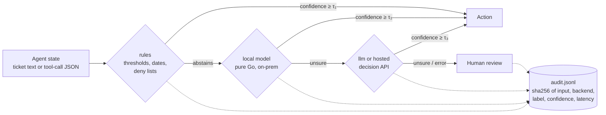

# agent-decision-gate

**Not every agent decision needs an LLM.** A Go library and CLI for the closed decisions inside an agent loop: which queue a ticket goes to, whether a tool call may run, whether an answer passes a rule. You get one interface, pluggable backends, and a confidence gate that escalates what the cheap backend is unsure about.

- `rules`: deterministic rules. This is the baseline, and the right tool for thresholds, dates and permissions.
- `local`: a small trainable text classifier in pure Go (logistic regression or naive Bayes over char n-grams with accent folding). No CGO, no network. It trains from JSONL and saves to a file.
- `llm`: any OpenAI-compatible chat endpoint (OpenAI, Ollama, vLLM...) with JSON-schema structured output, constrained to the label enum.
- `httpdecision`: a generic adapter for hosted decision APIs, configured by URL, a JSON body template and response paths. No vendor schema is hardcoded.
- `Gate`: escalates `rules → local → llm → human` by confidence threshold, and writes every decision to an audit JSONL file (input hash, backend, label, confidence, latency).
- `decide` CLI: `train`, `predict`, `bench` (accuracy, macro-F1, ECE, p50/p95 latency, cost per decision, coverage at a threshold).

Article (Spanish and English): https://numoru.com/en/contributions/modelos-de-decision-agentes

Licence: Apache 2.0. The example datasets are **synthetic**.

## Why

From September 2026, vendors started shipping "decision models" (TypeSafe's Jev, the OpenAI Decisions API, Gemini Decision 1, Microsoft-Decision-1, Cloudflare's open-weights Clef). They take a state plus a typed question and return a label with a probability, without generating text. Vendors report large speed and cost gains (TypeSafe cites 193.6× faster and 444.6× cheaper on its own evals, and calls those figures "on the higher end"). Those numbers are vendor-reported. The one early independent audit we know of (arXiv 2609.32160) finds the gains are in latency and cost, not accuracy.

The architecture holds whichever vendor you pick. Code computes numbers, dates and permissions. A fast classifier handles the closed decisions it is confident about. Anything doubtful goes to an LLM or a person. This repo is that architecture, with an interface that lets you swap the classifier, including for one you run on your own machines.

## Architecture



```go
type Decider interface {
    Name() string
    Decide(ctx context.Context, q Question, state string) (Result, error)
}

type Result struct {
    Label      string
    Confidence float64
    Probs      map[string]float64
    Backend    string
    Latency    time.Duration
    CostUSD    float64
}
```

## Quickstart

Requires Go 1.22+.

```sh
go build -o bin/decide ./cmd/decide

# 1. Train the local model on the synthetic Spanish tickets (300 examples, under a second)
bin/decide train -data examples/tickets-es/synthetic-train.jsonl -out models/tickets.gz

# 2. One decision
bin/decide predict -question examples/tickets-es/question.json -backend local=models/tickets.gz \
  "me rebota la factura con error CFDI40147"

# 3. A gate: rules first, then the local model, then a human. Audit log on disk.
bin/decide predict -question examples/tickets-es/question.json \
  -gate "rules=examples/tickets-es/rules.json@0.99,local=models/tickets.gz@0.6" \
  -log audit.jsonl < my-tickets.txt

# 4. Benchmark
bin/decide bench -question examples/tickets-es/question.json \
  -test examples/tickets-es/synthetic-test.jsonl \
  -backends "rules=examples/tickets-es/rules.json,local=models/tickets.gz" \
  -gate "rules=examples/tickets-es/rules.json@0.99,local=models/tickets.gz@0.6" -threshold 0.6
```

As a library:

```go
q, _ := decision.LoadQuestion("examples/tickets-es/question.json")
r, _ := rules.Load("examples/tickets-es/rules.json")
m, _ := local.Load("models/tickets.gz")
l, _ := llm.New(llm.FromEnv())

g := &decision.Gate{
    Stages: []decision.Stage{
        {Decider: r, MinConfidence: 0.99},
        {Decider: local.Decider{M: m}, MinConfidence: 0.6},
        {Decider: l, MinConfidence: 0.7},
    },
    HumanLabel: "escalar_humano",
    Log:        auditFile,
}
out, err := g.Decide(ctx, q, ticketText)
if out.NeedsHuman { /* open a review task */ }
```

## Measured results (synthetic data, one laptop)

Measured on 2026-11-22 on an Apple M3 Pro laptop with Go 1.27.4. Full output and commands are in [`results/2026-11-22-m3pro-synthetic.md`](results/2026-11-22-m3pro-synthetic.md). **These numbers describe this repo's backends on our synthetic data. They are not a claim about any vendor's model.**

Spanish e-invoicing tickets, 7 labels, 100 test examples whose base phrasings never appear in training:

| backend | accuracy | macro-F1 | ECE | p50 | p95 | cost/decision | auto-decided @0.6 | accuracy on auto-decided |
|---|---|---|---|---|---|---|---|---|
| rules (keyword baseline) | 0.780 | 0.784 | 0.093 | 6 µs | 9 µs | 0 | 75% | 94.7% |
| local logreg | 0.750 | 0.756 | 0.117 | 45 µs | 74 µs | 0 | 62% | 90.3% |
| local naive Bayes | 0.730 | 0.728 | 0.270 | 33 µs | 60 µs | 0 | 100% | 73.0% |
| gate: rules@0.99 → logreg@0.6 → human | n/a | n/a | n/a | 6 µs | 67 µs | 0 | **83%** | **92.8%** |

What this shows, and what it doesn't:

- A keyword baseline written by someone who knows the domain is hard to beat with 300 examples. **Measure your baseline before buying a model.** (Caveat: our rules author also wrote the dataset, so that row is optimistic.)
- Calibration matters more than raw accuracy for gating. Naive Bayes is nearly as accurate as logistic regression, but it is confident about everything: 100% coverage at 73% accuracy, so a threshold cannot separate its right answers from its wrong ones.
- The cascade decides 83 of 100 tickets on its own at 92.8% accuracy and sends 17 to a person, with zero marginal cost and sub-millisecond latency. Where the remaining 17 go (an LLM, a hosted decision API, or a person) is a cost-and-risk choice you can now measure.
- In-process latency excludes the network. A hosted API adds at least one round trip from your region.

The tool-call gating example (12 test calls, a demonstration only): the rules decide 7 of 12 with no errors and abstain on the 5 whose risk depends on content, such as an email body or a reply that leaks a password. The gate sends 4 of those 5 to a human, and the only one the local model accepts is correct. That is the intended split: permissions and amounts in code, content judgement escalated.

### Running the LLM and hosted backends

No LLM numbers are published here, because the machine that produced them had no API key. To add them:

```sh
export LLM_BASE_URL=http://localhost:11434/v1   # Ollama; or https://api.openai.com/v1, a vLLM server...
export LLM_API_KEY=...                          # empty for local servers
export LLM_MODEL=qwen2.5:7b-instruct
export LLM_PRICE_IN_PER_M=0      # USD per million input tokens, for the cost column
export LLM_PRICE_OUT_PER_M=0
# export LLM_JSON_SCHEMA=0       # if your server lacks json_schema; falls back to json_object

bin/decide bench -question examples/tickets-es/question.json \
  -test examples/tickets-es/synthetic-test.jsonl \
  -backends "rules=examples/tickets-es/rules.json,local=models/tickets.gz,llm"
```

For a hosted decision API, write an `httpdecision` config. `examples/httpdecision/jev-choice.json` follows the request and response shape in TypeSafe's public quickstart (`POST /v1/systemone`, `answers.<id>.choice`). We read that shape on 2026-11-22 but have **not** called the live API, so check the current docs before you rely on it. `examples/httpdecision/generic.json` is a template for your own service, such as open weights (Clef, Clef-flash) behind a small HTTP wrapper on your own GPU.

```sh
export TYPESAFE_API_KEY=...
bin/decide bench ... -backends "local=models/tickets.gz,http=examples/httpdecision/jev-choice.json"
```

## Data formats

- Question (`question.json`): `{"name": "...", "description": "...", "labels": [{"name": "...", "description": "..."}]}`. Label descriptions go into the LLM prompt and into hosted-API templates.
- Dataset (JSONL): `{"id": "...", "text": "...", "label": "..."}` per line. `state` is accepted instead of `text`, and may be a JSON object such as a tool call.
- Rules (`rules.json`): `any` keywords (folded), `regex`, and `fields` conditions on JSON state (`>`, `>=`, `<`, `<=`, `==`, `!=`, `in`, `not_in`, `contains`, `exists`, `older_than_days`, `newer_than_days`). Use `final: true` for hard denies. When no rule fires, the backend returns `default` with confidence 0, which a gate treats as "abstain".
- Audit log: one JSON object per stage attempt with `ts`, `question`, `input_sha256`, `stage`, `backend`, `label`, `confidence`, `threshold`, `latency_ms`, `cost_usd`, `accepted` and `error`. The input text itself is never written.

## Examples

- [`examples/tickets-es/`](examples/tickets-es/): **synthetic** Spanish support tickets for a Mexican e-invoicing (CFDI 4.0) product, with labels `cfdi_rechazado`, `complemento_pago`, `cancelacion`, `certificado_csd`, `acceso_cuenta`, `facturacion_general` and `escalar_humano`. 300 train and 100 test.
- [`examples/tool-gating/`](examples/tool-gating/): **synthetic** proposed tool calls for a support agent, labelled `allow`, `deny` or `ask_human`. 24 train and 12 test.
- [`examples/gen/`](examples/gen/): the generator. `go run ./examples/gen` rewrites both datasets, and a test fails if the committed files drift from its output.

## Honest limitations

- **Synthetic data.** The tickets were written and varied by us. Real tickets are longer and messier, and they come with attachments, mixed languages and new SAT complements that did not exist at training time. Our numbers say nothing about your traffic. Label a few hundred anonymised real examples and rerun `bench`.
- **Small test sets.** With 100 examples, one ticket is one point of accuracy, so differences of a few points are noise. The 12-example tool-gating set is a demo.
- **The rules author knew the data.** See above. A rules baseline written blind would likely score lower.
- **The local model is deliberately simple.** It is a linear model over n-grams. It cannot reason, count or read dates, and it will not recognise a label it has never seen. That is why the gate exists.
- **LLM confidence is self-reported** and usually poorly calibrated. Measure ECE on your data before you pick a threshold for the `llm` stage.
- **`httpdecision` without a confidence path** returns confidence 1, so a gate always accepts its answer. Configure `confidence_path` or `probs_path` if you want escalation.
- **Not a security boundary on its own.** A classifier, local or hosted, does not treat adversarial content as hostile, and interface attacks on the adapters around a decision model have been shown (arXiv 2610.14404). Keep deterministic permissions (allowlists, IdP scopes) in front of any model-based gate.
- **Vendor figures** (Jev's 70–500 ms and 193.6×/444.6×, OpenAI's and Google's case studies) are vendor-reported. We did not reproduce them.

## Development

```sh
go test -race -cover ./...
go vet ./...
gofmt -l .
```

Stdlib only, with no third-party Go modules.

---

## En español

**No toda decisión de un agente necesita un LLM.** Esta librería en Go, con su CLI, sirve para las decisiones cerradas dentro del bucle de un agente: a qué cola va un ticket, si se permite una llamada a una herramienta, si una respuesta cumple una regla. Ofrece una sola interfaz con backends intercambiables (`rules`, `local`, `llm`, `httpdecision`) y un `Gate` que sube por umbral de confianza: reglas, luego modelo local, luego LLM o API de decisión hospedada y, al final, una persona. Cada decisión queda en un log JSONL auditable, con el hash del input y no el texto.

- **Reglas primero.** Montos, fechas, permisos y listas de bloqueo son código, no la opinión de un modelo.
- **Modelo local propio.** Es un clasificador en Go puro, sin CGO ni red, que se entrena con un JSONL y se guarda en un archivo. Corre en tu infraestructura y tus datos no salen de ella.
- **LLM o API hospedada solo para lo dudoso.** Se configuran por variables de entorno (`LLM_BASE_URL`, `LLM_API_KEY`, `LLM_MODEL`) o con una plantilla JSON.

Inicio rápido:

```sh
go build -o bin/decide ./cmd/decide
bin/decide train -data examples/tickets-es/synthetic-train.jsonl -out models/tickets.gz
bin/decide predict -question examples/tickets-es/question.json -backend local=models/tickets.gz "no puedo timbrar, me rebota el RFC"
bin/decide bench -question examples/tickets-es/question.json -test examples/tickets-es/synthetic-test.jsonl \
  -backends "rules=examples/tickets-es/rules.json,local=models/tickets.gz" \
  -gate "rules=examples/tickets-es/rules.json@0.99,local=models/tickets.gz@0.6" -threshold 0.6
```

Resultados medidos el 2026-11-22 en una laptop Apple M3 Pro con **datos sintéticos**. No son una afirmación sobre ningún fabricante. La cascada reglas → regresión logística → persona decide sola 83 de 100 tickets, con 92.8 % de exactitud, y manda 17 a una persona, con costo marginal cero y latencia por debajo del milisegundo dentro del proceso. Un baseline de palabras clave (0.78 de exactitud) le gana al modelo local entrenado con 300 ejemplos (0.75). Por eso conviene medir el baseline antes de comprar un modelo. Naive Bayes casi empata en exactitud, pero está demasiado seguro de todo y no sirve para escalar por umbral.

Limitaciones: los datos son sintéticos y escritos por nosotros, el set de prueba es pequeño y el autor de las reglas conocía las frases. Las cifras de los fabricantes (Jev, Decisions API, Gemini Decision) son autorreportadas y no las reprodujimos. Ningún clasificador es por sí solo una barrera de seguridad.

Artículo completo: https://numoru.com/es/contributions/modelos-de-decision-agentes
